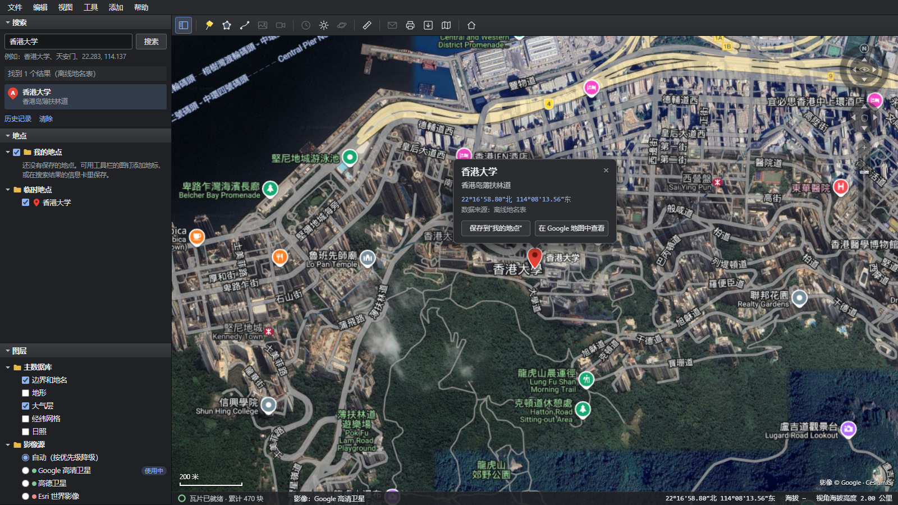

# 探索全球 · ExplorerGlobal

> **一个面向中国大陆、本地可运行的「谷歌地球式」三维数字地球。** 双击即可在浏览器里运行，无需部署、无需后端、大陆网络不开 VPN 也能正常访问。

[English](#english) · [快速开始](#快速开始) · [功能](#功能) · [路线图](#路线图)

---

## 这是什么

**探索全球 · ExplorerGlobal** 是一个在浏览器中运行的三维数字地球网页应用。它 1:1 复刻了谷歌地球（Google Earth）的界面布局与操作手感：深色界面、搜索飞行定位、高清卫星影像、可倾斜旋转的 3D 视角——但它是独立实现，**不是谷歌地球**。

核心定位是一个**国内可用、以 3D 高斯建筑（3DGS）为核心的众包数字地球平台**：用户注册后可在真实地理位置上传高斯建筑模型，平台按地理组织、按需加载，逐步拼成一张「高斯版地球」。

当前仓库已完成**三维地球浏览器 + 影像降级 + 中国大陆注记纠偏**这一阶段，3DGS 众包上传为下一阶段路线图（见 [路线图](#路线图)）。

---

## 截图



---

## 快速开始

> 需要 [Node.js](https://nodejs.org/)（本机实测 v24；没有 Node 时脚本会尝试退回 Python 起服务）。

1. **双击 `启动.bat`** —— 脚本会自动结束占用端口的进程、启动本地服务、用默认浏览器打开页面。
2. 浏览器访问 <http://localhost:8091/>。

想换端口：`启动.bat 8095`。关掉弹出的黑色命令行窗口即停止服务。

建议使用 Chrome 或 Edge。

---

## 功能

- **高清卫星影像**：Google 高清卫星（`scale=2` 512px 瓦片）为主，自动降级到高德、Esri、本地蓝色大理石底图。
- **大陆不开 VPN 可用**：启动时按优先级探测影像源，用第一个连得上的；运行中当前源失效会自动切换并提示，高优先级源恢复后自动切回。关掉梯子也能用，画面自动换成高德。
- **中国大陆注记纠偏**：Google 的卫星图是准的，但其道路/地名注记在大陆带 300–500 米偏移。程序自动把大陆范围内注记挪回正确位置（港澳台及国外不动）。
- **1:1 谷歌地球式界面**：顶部菜单栏、左上搜索栏、左侧「地点」与「图层」面板、右上 3D 导航环、底部状态栏（瓦片进度 / 影像源 / 经纬度 / 海拔）。
- **搜索飞行定位**：输入地名或坐标（如 `22.283, 114.137`），相机沿缓动曲线飞行 2 秒停在目标上空，落下地标并弹出信息卡。地名解析顺序：经纬度 → 内置离线地名表 → OpenStreetMap / Esri 在线检索。
- **地点管理**：保存「我的地点」（可重命名、删除、导出 KML），双击条目飞过去。
- **图层控制**：边界和地名、地形、大气层、经纬网格、日照、影像源切换。
- **工具**：添加地标 / 多边形 / 路径、日照、标尺、打印、保存图像、在 Google 地图中查看、回到初始视图。
- **高清渲染**：LOD 屏幕误差 1.5、FXAA 抗锯齿、Google `scale=2` 注记。

---

## 操作

| 操作 | 效果 |
|---|---|
| 左键拖动 | 平移（快速甩出带惯性滑行） |
| 滚轮 | 朝鼠标所指位置缩放 |
| 左键双击 / 右键双击 | 放大一级 / 缩小一级 |
| 右键拖动 | 缩放 |
| 中键拖动，或 Shift/Ctrl + 左键拖动 | 上下倾斜、左右旋转 |
| 方向键 | 平移 |
| `+` / `-`，PageUp / PageDown | 缩放 |
| `N` / `U` / `R` | 正北朝上 / 恢复俯视 / 朝向倾斜复位 |
| Ctrl + F | 光标跳到搜索框 |

完整列表见「帮助 → 键盘与鼠标操作」。右上角 3D 导航环也可完成旋转、倾斜、缩放。

---

## 影像源与网络

| 影像源 | 需要梯子 | 说明 |
|---|---|---|
| Google 高清卫星 | 是 | 默认首选，`scale=2` 高清瓦片 + 注记 |
| 高德卫星 | 否 | 国内直连，自动降级目标 |
| Esri 世界影像 | 视网络而定 | 部分网络环境 403 |
| 本地蓝色大理石 | 否 | 随项目自带，完全断网也可显示（较粗糙） |

影像源地址与优先顺序在 `js/config.js` 的 `GE.sources` 里，可自行增改。填入自己的 Google Maps API 密钥（`googleMapsApiKey`，需开通 Map Tiles API）后，可启用 Google 实景三维模型。

---

## 技术栈

- **三维引擎**：[CesiumJS](https://cesium.com/cesiumjs/) 1.147（Apache 2.0）
- **前端**：原生 JavaScript + CSS，无构建步骤
- **后端**：Node.js 内置 `http` 模块，**零第三方依赖**（`server.js`）
- **地形**：Esri World Elevation
- **地名检索**：OpenStreetMap Nominatim、Esri
- **大陆轮廓**：阿里云 DataV.GeoAtlas；港澳轮廓 © OpenStreetMap 贡献者（ODbL）

---

## 目录结构

```
启动.bat             双击启动
server.js            本地静态服务（无第三方依赖）
index.html           页面
css/earth.css        界面样式
js/config.js         参数、影像源、离线地名表
js/imagery.js        影像源探测、降级、恢复、坐标纠偏
js/label-worker.js   后台线程：拼合纠偏后的注记瓦片
js/region.js         判断点是否在中国大陆
js/region-cn.js      大陆、香港、澳门轮廓数据
js/controls.js       键盘、鼠标、导航环的相机控制
js/search.js         搜索、飞行、地标、信息卡
js/ui.js             菜单、面板、工具栏、状态栏
js/main.js           初始化
lib/Cesium/          CesiumJS 1.147
assets/              蓝色大理石底图、截图、图标
tools/               测试脚本与源数据（运行不需要）
```

---

## 路线图

- [x] 三维数字地球浏览器 + 谷歌地球式界面与操作
- [x] 多影像源自动降级（大陆不开 VPN 可用）
- [x] 中国大陆注记纠偏
- [ ] **3D 高斯建筑（3DGS）众包上传**：用户注册后可在真实地理位置上传高斯模型，平台按地理组织、按需加载，逐步拼成「高斯版地球」
- [ ] Google 实景三维接入（需 API 密钥）
- [ ] 街景 / 历史影像 / 游览录制 / 星空·火星·月球

---

## 数据来源与版权

- 卫星影像与注记：Google、高德、Esri，在线按需加载，版权归各自所有，仅供个人学习使用。
- 本地底图：NASA Blue Marble。
- 三维引擎：CesiumJS（Apache 2.0）。
- 地形：Esri World Elevation。
- 地名检索：OpenStreetMap Nominatim、Esri。
- 大陆轮廓：阿里云 DataV.GeoAtlas；港澳轮廓 © OpenStreetMap 贡献者（ODbL）。

---

## 与谷歌地球的差别

本项目使用开源引擎 CesiumJS + 自研界面实现，未使用 Google Earth 程序代码。影像是浏览时按需从各家服务器获取的：

- 默认没有建筑和树木的三维模型（除非填入 API 密钥启用 Google 实景三维）。
- 没有街景、历史影像、游览录制、火星和月球。
- `mt0–3.google.com` 的瓦片地址非 Google 公开承诺接口，可能限流或失效；失效时自动切换高德。正式途径为 Google Map Tiles API。

---

<a name="english"></a>
## English

**ExplorerGlobal** is a Google-Earth-style 3D digital globe that runs entirely in your browser, locally, with zero backend dependencies — and works inside mainland China without a VPN.

- Double-click `启动.bat` to launch (requires Node.js).
- HD satellite imagery (Google → Gaode/Amap → Esri → local Blue Marble) with automatic failover.
- Google-Earth-style UI and controls, offline gazetteer, KML place management.
- Long-term vision: a **crowdsourced 3D Gaussian Splatting (3DGS) digital globe** — users upload Gaussian building models at real geographic locations, assembled on demand into a "Gaussian Earth".

---

## License

待定（本项目为公开开源项目，授权方式由作者决定）。
